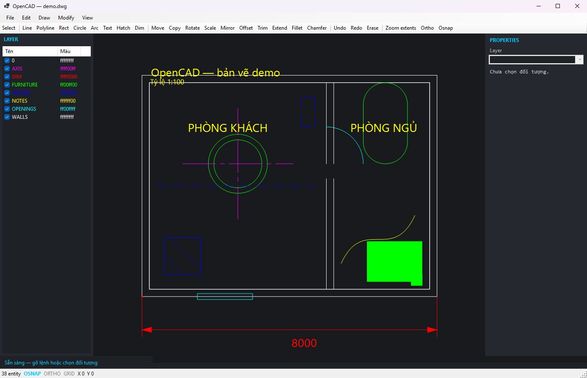
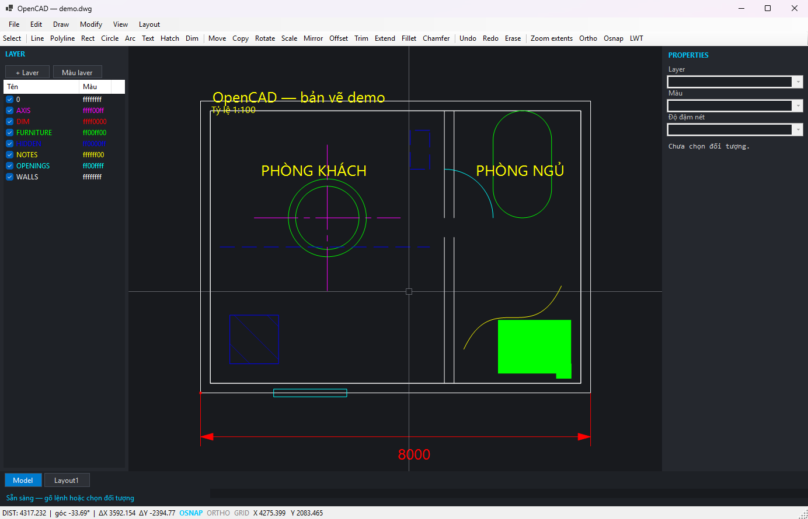
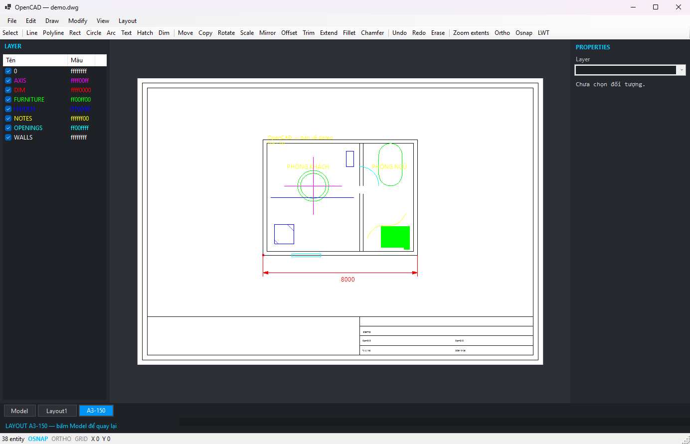
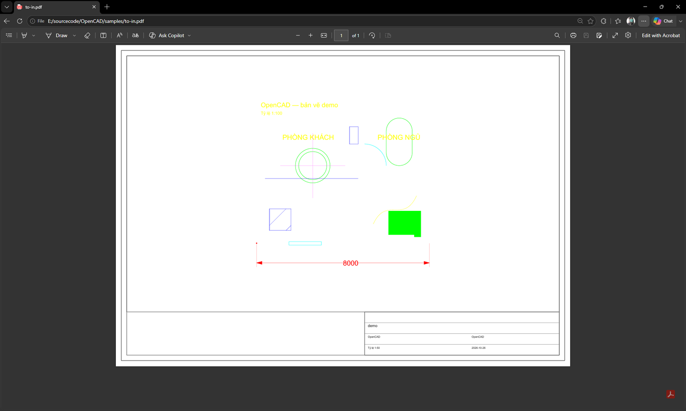
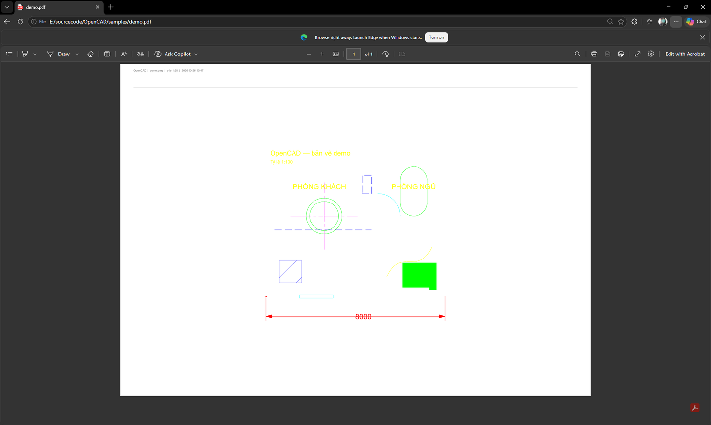
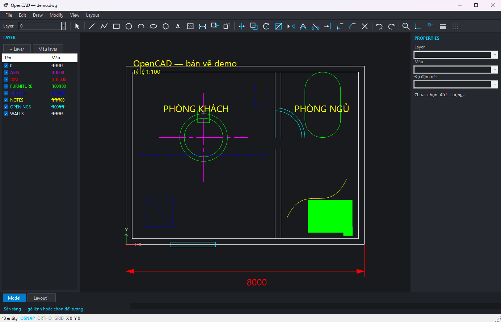

# OpenCAD

[](https://github.com/realkhoa/OpenCAD/actions/workflows/build.yml)

> **Trạng thái sau 145 vòng** — số liệu kiểm chứng đầy đủ ở [docs/status.md](docs/status.md):
> 943 test Core + 207 test UI + 14 cổng kiểm, tất cả xanh; 20 loại entity vẽ được, **113 lệnh**, ~27.300 dòng C#.

Trình soạn thảo CAD desktop: **mở DWG/DXF → xem → vẽ/sửa bằng lệnh kiểu AutoCAD → lưu ngược ra DWG/DXF**.

Engine dùng **ACadSharp** (MIT) — không cần AutoCAD, không cần license thương mại.



---

## Chạy thử

```powershell
dotnet build
dotnet run --project src/OpenCad.App -- samples/demo.dwg
```

Kiểm thử tự động (headless, chạy được trong CI):

```powershell
dotnet run --project tools/OpenCad.Tools -- smoke      # 943 kiểm tra Core

# 220 kiểm tra UI: chạy thử 109/109 lệnh + mô phỏng chuột
src/OpenCad.App/bin/Debug/net10.0-windows/OpenCad.App.exe --uitest

# 14 cổng kiểm: lệnh, tài liệu, alias, CLI↔app, test giả, giới hạn, tuyên bố, vòng đời, fixture, quy trình, kéo grip, độ phủ vẽ, mã chết, bất biến
dotnet run --project tools/OpenCad.Tools -- checkall

dotnet run --project tools/OpenCad.Tools -- lossy      # 22 loại entity qua lưu/đọc, kiểm cả NỘI DUNG
dotnet run --project tools/OpenCad.Tools -- torture    # bản vẽ phức tạp: vẽ + lưu
dotnet run --project tools/OpenCad.Tools -- audit samples/demo.dwg
dotnet run --project tools/OpenCad.Tools -- sample samples/demo.dwg
dotnet run --project tools/OpenCad.Tools -- mksample samples/can-ho.dwg
```

---

## Tính năng

### Đọc / ghi

| Định dạng | Đọc | Ghi |
| :--- | :--- | :--- |
| DWG R14 → 2018 (AC1014–AC1032) | ✅ | ✅ (trừ AC1021) |
| DXF ASCII + binary (AC1009+) | ✅ | ✅ |

### Hiển thị

- Pan (chuột giữa), zoom (lăn chuột, neo theo con trỏ), zoom extents (`Ctrl+E`)
- Màu ACI 256 màu + true color, màu theo layer, ẩn/hiện layer
- **Line type**: đọc pattern thật từ `LineType.Segments` trong file (DASHED, CENTER, HIDDEN…),
  vẽ nét đứt ở không gian màn hình với sàn 2px để không biến mất khi zoom xa
- **HATCH**: đọc boundary path (line/arc/ellipse/polyline có bulge), tô đặc bằng even-odd
  nên vòng lồng nhau tạo lỗ đúng; hatch có pattern vẽ gạch chéo và cắt gọn trong vùng
- Culling theo hộp bao
- Entity: `LINE`, `CIRCLE`, `ARC`, `ELLIPSE`, `LWPOLYLINE`, `POLYLINE2D/3D`, `SPLINE`
  (de Boor + dự phòng Catmull-Rom), `TEXT`, `MTEXT`, `INSERT` (block lồng, mảng row/column),
  `SOLID`, `POINT`, `DIMENSION` (qua block hình học)

### Bắt điểm & trợ giúp vẽ

- **OSNAP**: endpoint, midpoint, center, quadrant, intersection, nearest — có marker và nhãn
- **ORTHO** (`F8`): khoá phương ngang/dọc
- **POLAR** (`F10`): bắt hướng theo bước góc (15°), giữ nguyên khoảng cách
- Ưu tiên snap theo chuẩn CAD: endpoint > intersection > midpoint > center > quadrant > nearest

<!-- COMMANDS:START -->
_Tổng: 113 lệnh. Phần này sinh tự động từ `CommandRegistry` — chạy `docs` để cập nhật._

**Vẽ**

| Lệnh | Viết tắt | Mô tả |
| --- | --- | --- |
| `LINE` | `L` | Vẽ đoạn thẳng liên tiếp |
| `PLINE` | `PL` | Vẽ polyline |
| `RECTANG` | `REC` | Vẽ hình chữ nhật |
| `CIRCLE` | `C` | Vẽ đường tròn |
| `ARC` | `A` | Vẽ cung 3 điểm |
| `ELLIPSE` | `EL` | Vẽ ellipse |
| `XLINE` | `XL` | Đường dựng vô hạn qua 2 điểm |
| `RAY` |  | Tia vô hạn từ 1 điểm theo hướng |
| `POLYGON` | `POL` | Vẽ đa giác đều |
| `SPLINE` | `SPL` | Vẽ đường cong qua các điểm click |
| `POINT` | `PO` | Đặt điểm |
| `MLINE` | `ML` | Tường nhiều nét |
| `TEXT` | `T`, `DT` | Đặt chữ một dòng |
| `MTEXT` | `MT` | Đặt chữ nhiều dòng |
| `HATCH` | `H` | Tô vật liệu |
| `DIVIDE` | `DIV` | Chia đối tượng thành N đoạn |
| `MEASURE` | `ME` | Đặt điểm cách đều |
| `INSERT` | `I` | Chèn block |
| `PTEXT` | `PT` | Ghi chú trên tờ in |
| `SHEETLINE` | `SL` | Vẽ đường trên tờ in |
| `ATTDEF` | `AD` | Thêm attribute vào block |

**Chèn**

| Lệnh | Viết tắt | Mô tả |
| --- | --- | --- |
| `TABLE` | `TB` | Tạo bảng (hỏi số hàng,cột rồi click điểm chèn) |
| `HATCHPATTERNS` |  | Liệt kê các mẫu tô có sẵn |
| `PATLOAD` | `HATCHPATLOAD` | Nạp mẫu tô từ file .pat: PATLOAD duong/dan/acad.pat |
| `TABLECELL` |  | Đặt chữ vào ô bảng: TABLECELL hàng,cột,nội dung |

**Chú thích**

| Lệnh | Viết tắt | Mô tả |
| --- | --- | --- |
| `MLEADER` | `MLD` | Chú thích có đường dẫn: click mũi tên, click chữ, nhập nội dung |
| `TEXTSTYLE` | `FONT` | Đổi font chữ hiển thị: TEXTSTYLE Times New Roman |
| `TEXTANGLE` | `TORIENT` | Xoay chữ đang chọn tại chỗ: TEXTANGLE 45 |

**Sửa**

| Lệnh | Viết tắt | Mô tả |
| --- | --- | --- |
| `HATCHEDIT` | `HE` | Đổi tỷ lệ / góc / mẫu tô |
| `MOVE` | `M` | Dời đối tượng |
| `COPY` | `CO`, `CP` | Sao chép đối tượng |
| `ROTATE` | `RO` | Xoay đối tượng |
| `SCALE` | `SC` | Phóng to/thu nhỏ |
| `MIRROR` | `MI` | Lật đối xứng |
| `OFFSET` | `O` | Tạo đường song song |
| `TRIM` | `TR` | Cắt phần thừa |
| `EXTEND` | `EX` | Kéo dài tới đường biên |
| `FILLET` | `F` | Bo tròn góc |
| `CHAMFER` | `CHA` | Vát góc |
| `ERASE` | `E`, `DEL` | Xoá đối tượng |
| `ARRAY` | `AR` | Dãy chữ nhật |
| `ARRAYPOLAR` | `ARP` | Dãy tròn |
| `STRETCH` | `S` | Kéo giãn |
| `ATTEDIT` | `ATT` | Sửa giá trị attribute |
| `DDEDIT` | `ED`, `TEDIT` | Sửa nội dung chữ |
| `MATCHPROP` | `MA` | Chép thuộc tính từ đối tượng nguồn |
| `COPYCLIP` |  | Copy lựa chọn (Ctrl+C) |
| `PASTECLIP` |  | Dán từ clipboard (Ctrl+V) |
| `LAYDEL` |  | Xoá layer đang chọn VÀ mọi đối tượng trên đó |
| `OOPS` |  | Phục hồi đối tượng vừa xoá |
| `EXPLODE` | `X` | Bung block / polyline thành đối tượng đơn |
| `JOIN` | `J` | Nối các đoạn thẳng thành một polyline |
| `SELLAYER` |  | Chọn mọi đối tượng trên một lớp |
| `SELTYPE` |  | Chọn mọi đối tượng cùng loại |
| `SELINVERT` |  | Đảo lựa chọn |
| `SELECTUNDER` | `SELALLD` | Chọn mọi đối tượng chồng nhau dưới con trỏ |
| `PEDIT` | `PE` | Sửa polyline: PE close | PE open | PE join |
| `OVERKILL` |  | Xoá đối tượng trùng hình học (giữ bản đầu) |
| `OVERKILLMERGE` | `OVM` | Gộp các đoạn thẳng chồng/nối tiếp trên cùng đường |

**Xem**

| Lệnh | Viết tắt | Mô tả |
| --- | --- | --- |
| `LAYISO` |  | Ẩn mọi layer trừ layer của đối tượng đang chọn |
| `LAYUNISO` |  | Bật lại mọi layer |
| `ZOOM` | `Z` | Phóng to/thu nhỏ |
| `ZOOMALL` | `ZA` | Xem toàn bản vẽ |
| `ZOOMWINDOW` | `ZW` | Phóng tới vùng chọn bằng 2 click |
| `ZOOMPREVIOUS` | `ZP` | Quay lại khung nhìn trước |
| `OSNAP` | `OS` | Bật/tắt bắt điểm |
| `ORTHO` |  | Bật/tắt chế độ trực giao |
| `POLAR` |  | Bật/tắt rãnh căn 15° |
| `ZOOMOBJ` | `ZO` | Phóng tới các đối tượng đang chọn |
| `LTSCALE` | `LTS` | Tỷ lệ kiểu nét: LTSCALE 2 |

**Kích thước**

| Lệnh | Viết tắt | Mô tả |
| --- | --- | --- |
| `DIMTEDIT` |  | Ghi đè chữ số đo của kích thước |
| `DIMLINEAR` | `DLI`, `DIM` | Kích thước thẳng đứng/ngang |
| `DIMALIGNED` | `DAL` | Kích thước song song |
| `DIMANGULAR` | `DAN`, `DIMANG` | Kích thước góc |
| `DIMRADIUS` | `DRA`, `DIMRAD` | Kích thước bán kính |
| `DIMDIAMETER` | `DDI`, `DIMDIA` | Kích thước đường kính |
| `DIMORDINATE` | `DOR`, `DIMORD` | Kích thước toạ độ |
| `DIMCONTINUE` | `DCO` | Nối tiếp chuỗi kích thước |
| `DIMBASELINE` | `DBA` | Kích thước song song từ một gốc |
| `DIMSTYLE` | `DST` | Đổi kiểu kích thước |

**Đo**

| Lệnh | Viết tắt | Mô tả |
| --- | --- | --- |
| `DIST` | `DI` | Đo khoảng cách |
| `AREA` | `AA` | Đo diện tích |

**Block**

| Lệnh | Viết tắt | Mô tả |
| --- | --- | --- |
| `BLOCK` | `B` | Tạo block từ lựa chọn |
| `BLOCKS` | `BL` | Liệt kê block |
| `ATTSYNC` |  | Đồng bộ attribute của mọi insert theo định nghĩa block |
| `IMPORT` |  | Nạp một DWG khác thành block: IMPORT duong/dan/tep.dwg [tên] |
| `ATTOUT` |  | Xuất bảng attribute của mọi block ra CSV: ATTOUT thong-ke.csv |

**Tệp**

| Lệnh | Viết tắt | Mô tả |
| --- | --- | --- |
| `NEW` |  | Bản vẽ mới |
| `OPEN` |  | Mở bản vẽ |
| `SAVE` | `QSAVE` | Lưu |
| `SAVEAS` |  | Lưu thành tệp mới |
| `PDF` | `EXPORTPDF` | Xuất PDF |
| `PLOT` |  | In |
| `SKIP` | `UNSUPPORTED` | Liệt kê đối tượng chưa hỗ trợ |
| `LAYOUTDEL` |  | Xoá layout đang mở (không xoá layout cuối) |
| `PLOTSTYLE` |  | Nạp bảng kiểu in theo lớp: PLOTSTYLE samples/kieu-in.txt |
| `WBLOCK` | `WB` | Xuất lựa chọn ra tệp DWG riêng: WBLOCK duong/dan/ra.dwg |
| `SCRIPT` | `SCR` | Chạy tệp script .scr: SCRIPT duong/dan/tep.scr |
| `AUDIT` |  | Rà bản vẽ tìm lỗi dữ liệu |
| `PURGE` |  | Dọn layer/block/kiểu nét không dùng |
| `AUTOSAVE` |  | Ghi autosave ngay và báo trạng thái |

**Khác**

| Lệnh | Viết tắt | Mô tả |
| --- | --- | --- |
| `UNDO` | `U` | Hoàn tác (U 5 = lùi 5 bước) |
| `REDO` |  | Làm lại |
| `SELECTALL` | `SELECT` | Chọn tất cả |
| `VPORT` | `VP` | Tạo viewport trên tờ |
| `VPSCALE` | `VS` | Đổi tỷ lệ viewport (50 = 1:50) |
| `LAYER` | `LA` | Xem danh sách layer; LA <tên> đặt layer hiện hành |
| `INFO` |  | Thống kê bản vẽ: số đối tượng theo loại, layer, vùng |
| `LIST` | `LS` | Mô tả chi tiết đối tượng đang chọn (loại, lớp, màu, hình học) |
| `LINETYPES` |  | Liệt kê kiểu nét của bản vẽ |
| `LINETYPELOAD` |  | Nạp các kiểu nét chuẩn (DASHED, HIDDEN, CENTER…) |
| `DIAG` | `DIAGNOSTICS` | In chẩn đoán: lỗi gần nhất, file log crash |
| `HELP` | `?` | Danh sách lệnh |

<!-- COMMANDS:END -->

### Đo đạc

| Lệnh | Phím tắt | Kết quả |
| :--- | :--- | :--- |
| `DIST` | `DI` | Khoảng cách, góc, ΔX/ΔY giữa 2 điểm — hiện ở status bar và log |
| `AREA` | `AA` | Diện tích vùng khép kín (polyline/hatch/đường tròn) |



### Lệnh sửa

| Lệnh | Phím tắt | Ghi chú |
| :--- | :--- | :--- |
| `MOVE` | `M` | Điểm gốc → điểm đích |
| `COPY` | `CO` | Như MOVE nhưng giữ bản gốc. **Lặp lại được**: click tiếp để sao chép thêm, `Esc` kết thúc |
| `ROTATE` | `RO` | Tâm xoay + click góc hoặc gõ số độ |
| `SCALE` | `SC` | Điểm gốc + gõ hệ số |
| `MIRROR` | `MI` | 2 điểm của trục đối xứng |
| `FILLET` | `F` | Chọn 2 đường thẳng → nhập bán kính → bo góc bằng cung tròn. **Hoặc chọn 1 polyline → bo tất cả góc** |
| `CHAMFER` | `CHA` | Chọn 2 đường thẳng → nhập khoảng vát (`10` hoặc `10,20`) |
| `OFFSET` | `O` | Chọn 1 đối tượng → nhập khoảng cách → click phía cần offset. Hỗ trợ line, circle, arc, polyline (bo góc miter) |
| `ARRAY` | `AR` | Chọn đối tượng → nhập `hàng,cột` (ví dụ `3,4`) → nhập `bước hàng,bước cột` |
| `ARRAYPOLAR` | `ARP` | Chọn đối tượng → nhập số bản → click tâm xoay (chia đều 360°) |
| `STRETCH` | `S` | Click 2 góc khung → điểm gốc → điểm đích. Chỉ đỉnh nằm trong khung mới dời |
| `DIVIDE` | `DIV` | Chọn 1 đối tượng → nhập số đoạn → đặt điểm chia đều |
| `MEASURE` | `ME` | Chọn 1 đối tượng → nhập khoảng cách → đặt điểm cách đều |
| `UNSUPPORTED` | | Liệt kê loại đối tượng chưa vẽ được (TABLE, 3DSOLID…) — chống mất dữ liệu âm thầm |
| `SL` | `SHEETLINE` | Trên tờ in: click 2 điểm để vẽ đường (toạ độ mm giấy) |
| `TRIM` | `TR` | Click đoạn cần cắt bỏ. Biên = mọi đối tượng khác (line, arc, circle, polyline) |
| `EXTEND` | `EX` | Click gần đầu cần kéo dài, tự tìm biên gần nhất theo hướng |
| `ERASE` | `E` / `Delete` | Xoá lựa chọn |
| `UNDO` / `REDO` | `Ctrl+Z` / `Ctrl+Y` | 200 bước |

Chọn đối tượng: click, `Shift`+click để cộng/trừ, kéo khung **trái → phải** = window
(phải nằm trọn), **phải → trái** = crossing (chạm là lấy). Kéo trực tiếp entity đang chọn để di chuyển.

### Xuất bản vẽ

- **PDF vector** (`Ctrl+P` hoặc lệnh `PDF`), khổ A3/A4 ngang
- **Tỷ lệ in cố định**: vừa trang, 1:50, 1:100, 1:200 — chọn từ menu `File > Export PDF`
- **In tờ có khung tên**: khung viền, viewport đặt bản vẽ đúng tỷ lệ, khung tên 4 dòng
  (tên bản vẽ, dự án, tỷ lệ, ngày). Bản vẽ quá lớn thì tự nới lên tỷ lệ quen dùng (1:100 → 1:250…)
- **Layout thật trong DWG**: tạo layout có khung, khung tên và viewport; lưu/đọc lại được
  qua file DWG (`Layout` + `BlockRecord` riêng), in ra PDF. Menu `Layout`.
- **`ATTOUT`**: xuất **bảng thống kê attribute** của mọi block ra CSV (`ATTOUT thong-ke.csv`) —
  cột `BLOCK, LAYER, X, Y` + mỗi tag attribute một cột; **UTF-8 BOM** để Excel đọc đúng tiếng Việt;
  ô có dấu phẩy được bọc nháy kép
- **`mkfixtures` + `checkfixtures`**: biến các lỗi tìm được từ **dữ liệu thật** thành **fixture trong repo**
  (`samples/fixtures/`), để canh tự động mà không cần bản vẽ bên ngoài:
  `repeated-text` (chữ cùng ký tự ở nhiều vị trí), `circle-hatch` (biên một cung tròn khép kín),
  `blocks-only` (chỉ block + attribute), `mixed-attributes` (màu/độ đậm/kiểu nét).
  Mỗi fixture phải: mở được, **không bỏ qua đối tượng**, **audit không báo trùng lặp nhầm**,
  và **round-trip giữ nguyên nội dung**.
  *Đã thử phá chữ ký → cổng báo `BÁO NHẦM 4 TRÙNG LẶP`, exit 1*
- **`interopedit`**: đúng nhu cầu *"mở lên edit, lưu file"* — mở bản vẽ thật, **sửa** (dời Line/Insert,
  đổi đỉnh polyline, đổi nội dung chữ, dời tâm đường tròn), lưu, mở lại và kiểm:
  **thay đổi có hiệu lực + MỌI đối tượng khác giữ nguyên chữ ký**.
  **Đã kiểm 10/10 bản vẽ GstarBIM** (kể cả tệp 14.316 đối tượng còn lại)
- **`interoprt`**: round-trip bản vẽ thật — mở → lưu bản sao → mở lại → so **dấu vân tay nội dung**:
  SHA-256 trên toàn bộ chữ ký hình học **+ màu + độ đậm + kiểu nét + thuộc tính lớp**, đã sắp xếp.
  **Đã kiểm 10 bản vẽ GstarBIM: dấu vân tay GIỐNG HỆT trước/sau — không mất cả hình học lẫn thuộc tính hiển thị**
- **Hiệu năng trên bản vẽ thật** (`Trivella.dwg`, 14.317 entity): mở **688 ms**, dựng scene **44 ms**,
  hit-test **0,05 ms/lần**, **vẽ khung hình 1600×900: 46 ms**, lưu **299 ms**; tệp 365 KB → 366 KB (không phình)
- **`interop`**: mở bản vẽ do **phần mềm khác tạo** (read-only, không ghi) và báo cáo số đối tượng/layer/block,
  số vẽ được, loại bỏ qua, lỗi audit. **Đã kiểm 10 bản vẽ kiến trúc thật (GstarBIM, tổng ~24.000 đối tượng,
  tệp lớn nhất 14.317)**: **10/10 mở được, 0 đối tượng bị bỏ qua**
- **`workflow`**: chạy **trọn một quy trình làm hồ sơ** và khẳng định từng bước —
  bản vẽ mới → 4 layer → tường 7000×5200 → cửa (cánh + cung) → kích thước 7000 → chữ tiếng Việt →
  tô ANSI31 → block cửa sổ có attribute + 2 insert → tờ A3 1:50 → in PDF → lưu → mở lại → audit →
  **lưu lần hai ổn định**. Hiện **18/18 bước ĐẠT**
- **`griphunt`** + stress trong `--uitest`: truy lùng lỗi **kéo grip bị crash** (người dùng báo).
  **704 lần kéo** — 500 qua `GripEdit.Move` (12 loại × 5 vùng toạ độ × 5 hướng), **204 qua chuột canvas thật**
  (8 loại × 3 vùng × 4 hướng), cộng các **trình tự quái**: đổi zoom giữa lúc kéo, xoá đối tượng giữa lúc kéo,
  Esc rồi rê tiếp. **Không tái hiện được** — 0 ngoại lệ, 0 toạ độ NaN
- **`lifecycle`**: **ma trận vòng đời** cho 13 loại entity tạo được — mỗi loại kiểm 5 bước:
  **vẽ → hit-test → MOVE → undo → lưu/đọc**. In bảng ✔/✘ để thấy ngay loại nào hỏng ở bước nào.
  *Chính ma trận này bắt lỗi trong test của tôi: hit-test ở tâm vùng bao là điểm rỗng với
  đường tròn/cung/ellipse — phải click lên nét vẽ*
- **`checkrender`**: đối chiếu **mọi lớp entity của ACadSharp** (68 lớp) với các nhánh vẽ, tính cả lớp cha
  (`DimensionAligned` vẽ qua `case Dimension`). Loại không vẽ và không khai báo → **báo lỗi**.
  *Đã thử: xoá nhánh `case XLine` → cổng báo `THIẾU NHÁNH VẼ: XLine`, exit 1*
- **`checkclaims`**: đối chiếu **tuyên bố trong README với thực tế** — số test Core ghi có khớp số chạy thật,
  số lệnh có khớp, và không lệnh nào vừa tồn tại vừa bị ghi trong mục "Còn thiếu thật".
  *Đã thử: sửa README thành "999 test Core" → cổng báo `SAI … thật là 910`, exit 1*
- **`checkdead`**: tìm thành viên `private`/`internal` trong tầng App **không được gọi ở đâu**. Cổng này bắt
  ngay `ResolvePdfFont` — hàm tôi khai báo ở vòng 147 nhưng **chưa từng gọi**, khiến tuyên bố "PDF dùng font
  đã chọn" là sai cho tới vòng 149
- **`XLINE`** (`XL`) và **`RAY`**: đường dựng vô hạn / tia — tạo bằng 2 điểm.
  *Hai loại này trước đây **vẽ được khi đọc từ tệp nhưng không tạo được**, và cũng **thiếu hẳn nhánh vẽ***
  (chỉ có nhánh biến đổi) — đã thêm cả hai, có bất biến canh
- **`LIST`** (`LS`): mô tả **chi tiết từng đối tượng đang chọn** — loại, lớp, màu, hình học (toạ độ + độ dài,
  tâm + bán kính, nội dung chữ…). Không chọn gì thì liệt kê cả bản vẽ
- **Tiền tố kích thước (DIMPOST)**: `DIMSTYLE prefix=L=` → số đo hiện `L=2000`; kết hợp được với hậu tố
  (`L=2000 mm`). *Tuyên bố cũ "Prefix bị nhân đôi" là **sai** — đã kiểm lại và sửa*
- **`TEXTANGLE`** (`TORIENT`): xoay chữ tại chỗ theo độ — **cả TEXT lẫn MTEXT** (MTEXT xoay qua `AlignmentPoint`) — hoặc sửa ô **Xoay** trong bảng Thuộc tính
  (hai ô: cao chữ + góc, mỗi ô để trống được). Có undo
- **`TEXTSTYLE`** (`FONT`): đổi font chữ hiển thị — `TEXTSTYLE Times New Roman`; tên không tồn tại bị từ chối,
  gõ không tham số thì liệt kê font đang dùng + font có trên máy
- **`checklimits`**: kiểm **các giới hạn ACadSharp đã ghi trong README** bằng reflection + round-trip thật.
  Nếu thư viện nâng cấp làm giới hạn biến mất, công cụ báo `THAY ĐỔI … → cập nhật README`. Nằm trong `checkall`
- **`IMPORT`**: nạp một DWG/DXF khác thành **block** trong bản vẽ hiện tại (mang theo lớp, tự đổi tên nếu
  trùng) — rồi `INSERT` để đặt. Cặp đối lập với `WBLOCK`, đủ quy trình thư viện block.
  **Block lồng bên trong tệp nguồn cũng được mang theo** và sống sót qua lưu/đọc lại (đã kiểm)
- **`WBLOCK`** (`WB`): xuất đối tượng đang chọn ra **tệp DWG/DXF riêng**, mang theo lớp và kiểu nét
  mà chúng dùng — tiện tách chi tiết hoặc tạo thư viện block
- **CLI cũng dùng được bảng kiểu in**: `pdf <dwg> <pdf> A3 fit mono style=samples/kieu-in.txt`;
  đường dẫn sai → báo lỗi rõ, exit 1 (không crash)
- **`PLOTSTYLE`** — bảng kiểu in theo lớp, **thay thế thực dụng cho `.ctb`** (định dạng nhị phân độc quyền).
  Tệp văn bản sửa được: `TUONG = 0.50`, `CUA = 0.35`, `TRUC = 0.13, color` (giữ màu), `default = 0.18`,
  `monochrome = true`. Có sẵn [`samples/kieu-in.txt`](samples/kieu-in.txt) cho bản vẽ mẫu căn hộ
- **File → Mở gần đây**: giữ 10 tệp gần nhất trong `%APPDATA%\OpenCAD\recent.txt`, không trùng, tự bỏ mục
  đã bị xoá khỏi đĩa — cấu hình lưu đầu tiên của app
- **LWT trên status bar**: bật/tắt hiện độ đậm nét (cùng hàng với OSNAP/ORTHO/POLAR/GRID).
  *Nút này từng mất im lặng khi bỏ toolbar ở vòng 81 — giờ có bất biến canh*
- **17 phím tắt trong menu** đã kiểm **không trùng nhau** và **có hiệu lực thật**: F3 (OSNAP thật sự đổi trạng thái),
  F7 GRID, F8 ORTHO, F10 POLAR, Ctrl+E zoom extents, Ctrl+`+`/`-` zoom
- **Phím tắt đầy đủ, xử lý tường minh**: `Ctrl+Z` hoàn tác, `Ctrl+Y` làm lại, `Ctrl+A` chọn tất cả,
  `Delete` xoá lựa chọn, `Esc` huỷ lệnh + bỏ chọn, `Ctrl+C/V` copy/dán.
  *Trước đây Ctrl+Z/Ctrl+Y chỉ dựa vào `ShortcutKeys` của menu — kiểm ra là **không hoạt động*** 
- **Gợi ý lệnh**: gõ `LI` → hiện `LINE (Tab)`, bấm Tab để chấp nhận; lịch sử lệnh bằng ↑ / ↓
- **Tab Model / Layout** ở đáy màn hình như AutoCAD; bấm tab để xem tờ in
  (giấy trắng, khung viền, khung tên, viewport cắt đúng khung)



**Sửa và vẽ được ngay trên tờ**: click chọn đối tượng paper space (sáng lên màu chọn), **kéo chuột để di chuyển**, `Delete` để xoá,
`PTEXT` đặt ghi chú, `SL` vẽ đường trên tờ, `ED` sửa chữ trên tờ — mọi thao tác đều có undo.
- **In bộ hồ sơ**: nhiều file DWG vào **một** PDF, mỗi file một tờ (`File > Export PDF > In bộ hồ sơ`)



- **Nhúng font TrueType** nên chữ tiếng Việt có dấu hiển thị đúng **và copy ra vẫn đúng** (có ToUnicode)
- **Độ đậm nét (lineweight)** đọc từ entity/layer; bật hiển thị bằng nút `LWT`
- **In theo màu kiểu CTB**: nét in đơn sắc, độ đậm lấy theo màu gốc (đỏ 0.13mm → magenta 0.7mm)
- Nét giữ nguyên vector — zoom/in không vỡ như ảnh raster
- Dải tiêu đề: tên file, tỷ lệ thật, ngày giờ
- Tôn trọng trạng thái ẩn/hiện layer: layer đang tắt sẽ không xuất
- Hatch tô đặc có chừa lỗ (even-odd), hatch pattern vẽ gạch chéo



### Bảng điều khiển

- **Layer**: bật/tắt hiển thị (layer tắt **không chọn được**), **khoá / đóng băng**, cột **Trạng thái**, **đổi tên**, **xoá** (chặn layer 0/layer đang dùng/còn đối tượng), chọn layer hiện hành, tạo layer mới, đổi màu layer
- **Properties**: loại, handle, layer, màu, độ đậm nét, thông số hình học.
  Đổi được **layer / màu (ACI) / độ đậm nét** cho cả lựa chọn, có undo
- **Command line**: gõ lệnh ở bất kỳ đâu (không cần click vào ô), có history `↑`/`↓`


### Giao diện kiểu AutoCAD

- **Toolbar có icon** (29 lệnh, nhóm bằng dấu phân cách) — icon vẽ bằng GDI+, không cần file ảnh
- **Theme tối toàn bộ**: menu, toolbar, panel, status bar
- **Layer combo trên toolbar** — đổi layer hiện hành ngay chỗ dùng nhiều nhất
- **UCS icon** ở gốc toạ độ (mũi X đỏ, Y xanh)
- **Menu chuột phải** trên vùng vẽ: chọn đối tượng → Move/Copy/Rotate/Scale/Mirror/Offset/Xoá;
  không chọn → Chọn tất cả; luôn có Lặp lại lệnh trước / Undo / Redo / Zoom extents
- **Crosshair toàn màn hình** + pickbox ở tâm con trỏ
- **Lưới điểm** (`F7`), mật độ tự đổi theo mức zoom (luôn ~45px giữa hai điểm)
- **Command history** (`F2`) — panel trượt hiện log có timestamp
- **Status bar toggle** bấm được: `OSNAP` `ORTHO` `POLAR` `GRID` (xanh đậm = đang bật)
- **Tab Model / Layout** ở đáy, dòng lệnh ở đáy



---

## Kiến trúc

```
src/OpenCad.Core/              Engine độc lập UI
  CadWorkspace.cs              Mở/lưu DWG-DXF, cờ "đã sửa"
  CadScene.cs                  Entity → primitive, hit-test, hộp bao, chọn theo khung
  Editing/
    EntityTransform.cs         Biến đổi affine cho mọi loại entity
    UndoStack.cs               Undo/redo + mốc lưu
    CadEditor.cs               Điều phối: sửa tài liệu + cập nhật scene + ghi lịch sử
  Snapping/SnapEngine.cs       OSNAP + ortho
  Rendering/                   Làm phẳng entity, primitive, bảng màu ACI
  Geometry/                    Pt, RectD, Affine2 (kể cả nghịch đảo)

src/OpenCad.App/               UI WinForms
  CadCanvas.cs                 Pan/zoom, chọn, kéo, công cụ vẽ, marker snap
  CadRenderer.cs               Vẽ GDI+
  ViewTransform.cs             World ↔ Screen
  Panels/                      LayerPanel, PropertiesPanel, CommandLine

tools/OpenCad.Tools/           CLI: sample | smoke | info
```

**Ba quyết định thiết kế chính:**

1. **Làm phẳng một lần.** Mỗi entity → `Prim` (đa tuyến/text/point), render và hit-test
   dùng chung. Cái gì nhìn thấy cũng click trúng được, không viết logic hình học hai lần.
2. **Một phép biến đổi cho mọi lệnh sửa.** MOVE/COPY/ROTATE/SCALE/MIRROR chỉ là các ma trận
   affine khác nhau, nên undo chỉ cần ma trận nghịch đảo — không phải viết hàm hoàn tác riêng
   cho từng lệnh.
3. **Undo là lệnh, không phải snapshot.** Ghi delegate thuận/nghịch, rẻ về bộ nhớ và cho phép
   undo thao tác xoá (thêm lại entity cũ).

---

## Đã kiểm chứng

`dotnet run --project tools/OpenCad.Tools -- smoke` — **661/661 PASS**:

- Ghi DWG → mở lại đúng số entity; round-trip DXF
- Mở → dịch entity → lưu → **mở lại xác nhận toạ độ** (sai số < 1e-6)
- MOVE / ROTATE 90° / SCALE 2x / MIRROR qua trục Y đúng hình học
- Undo trả entity về chỗ cũ; Redo áp lại; undo thao tác xoá phục hồi được entity
- Snap bắt đúng endpoint và center
- Window select vs crossing select phân biệt đúng
- Cờ "đã sửa" tự sạch khi undo về mốc lưu
- OFFSET line/circle/rect đúng khoảng cách và đúng phía (kể cả polyline khép kín)
- Line type nét đứt sinh pattern, nét liền thì không
- TRIM cắt giữa đoạn → 2 mảnh đúng độ dài; cắt đuôi → còn 1 mảnh; cắt đường tròn → 1 cung
- TRIM không có giao điểm trả về null thay vì xoá bừa
- EXTEND kéo đúng đầu được chọn tới biên; không có biên thì không làm gì
- Undo TRIM phục hồi đúng entity gốc (không chỉ đúng số lượng)
- HATCH gom đủ nhiều vòng biên, điểm trong lỗ không thuộc vùng tô, chọn được ở giữa vùng
- HATCH ghi/đọc lại DWG giữ nguyên; tạo được từ polyline khép kín và từ đường tròn
- FILLET sinh cung đúng bán kính và đúng tâm; cắt ngắn hai đường về điểm tiếp xúc, giữ nguyên đầu xa
- FILLET bán kính quá lớn hoặc hai đường song song → trả `null`, không phá hình
- CHAMFER cạnh vát dài đúng √(d1²+d2²)
- DIM tạo đủ đường gióng, đường kích thước, 2 mũi tên và chữ số đo đúng; ghi/đọc DWG giữ nguyên
- PDF: header/kết thúc đúng chuẩn, đúng khổ A3, **mọi offset trong xref trỏ đúng object**
  (Edge dễ tính nên phải tự kiểm), có cả path lẫn text, tỷ lệ hợp lý
- Tỷ lệ 1:50 cho đúng `units/mm` và đúng `scale` điểm/đơn vị
- PDF nhúng font dùng Type0 + Identity-H + CIDFontType2 + FontFile2 + ToUnicode,
  chữ trong content là glyph id hex (không còn chuyển dấu thành ASCII)
- Lineweight: W25→0.25mm, W50→0.5mm, Default→0.25mm, ByLayer lấy theo layer, lineweight riêng thắng ByLayer
- In CTB: nét đen, ACI 6 → 0.7mm (1.984pt), lineweight riêng 0.35mm (0.992pt), bản in màu vẫn giữ màu gốc
- Batch plot: 2 tờ trong một PDF, `/Count 2`, 2 MediaBox, **12/12 offset xref trỏ đúng object**
- In theo vùng: có lệnh cắt `re W n` nên hình ngoài vùng bị cắt gọn
- Tờ in: đúng khổ A3, có khung + khung tên + viewport clip, khung tên ghi đúng tỷ lệ,
  bản vẽ quá lớn tự nới tỷ lệ (1:50 → 1:250), PDF tờ in đúng MediaBox và xref hợp lệ
- Layout trong DWG: tạo được, có block record riêng, **ghi/đọc lại DWG vẫn còn**, đọc ra tờ in
  có viewport clip, PDF layout dùng nét đen (không còn nét trắng vô hình)
- Sửa thuộc tính: đổi màu/lineweight có undo, tạo layer (chặn trùng tên) có undo, đổi màu layer có undo
- FILLET polyline: mỗi góc thành 2 đỉnh + 1 cung, bulge đúng tan(22.5°) cho góc 90°,
  **chặn trường hợp hai góc kề chồng lên nhau** (r=80 trên cạnh 100 → không bo), r=40 vẫn bo đủ 4 góc
- DIMRAD vẽ được và có chữ `R50`; DIMDIA vẽ được và có chữ `Ø100`
- ELLIPSE có đúng bán trục; thoái hoá trả null
- POLYGON 6 cạnh khép kín, mọi đỉnh cách tâm đúng R; dưới 3 cạnh trả null
- DIST tính đúng bộ 3-4-5 (50, góc 53.13°, ΔX 30, ΔY 40)
- AREA: hình chữ nhật 100×50 → 5000; đường tròn xấp xỉ sai số < 1%; đường hở → 0
- Block: liệt kê đúng block người dùng (bỏ `*Model_Space`…), tìm không phân biệt hoa thường,
  block rỗng không tạo được insert, insert render đúng hình học và **đúng vị trí** (500,500 → 600,700)
- Tạo block: định nghĩa được tạo, entity dời về gốc (min X = 0), bản gốc thay bằng 1 insert,
  **hình vẫn nằm đúng chỗ** sau khi tạo, undo phục hồi cả bản gốc lẫn xoá định nghĩa, chặn trùng tên
- POLAR: 45° kẹp về trục X, **giữ nguyên khoảng cách**, 30° đúng góc, điểm trùng gốc không đổi
- Sửa chữ: đổi được nội dung, undo phục hồi, nội dung rỗng bị bỏ qua, **click trúng chữ thì hit-test thấy**
- **Click chọn được mọi loại**: Line, LwPolyline, Circle, Arc, Ellipse, Text, Point, Hatch (click trong vùng tô)
- **MOVE dịch đúng (100,100) cho cả 10 loại** — kể cả **Hatch** và **DimensionAligned**
  (hai loại này trước vòng 21 không dịch được, Δ = 0)
- **ROTATE 90° / SCALE 2× / MIRROR qua trục Y đúng cho cả 9 loại** đối tượng
- Mẫu tô xoay theo hình: xoay 30° → góc mẫu +0.524 rad; phóng 2× → tỉ lệ mẫu 1 → 2; dịch chuyển thì không đổi
- COPY: bản sao dịch đúng (100,50) và **bản gốc không đổi**, cho cả 8 loại
- UNDO sau xoay+phóng (ma trận 1.5/-0.8) phục hồi **chính xác** hộp bao cho cả 8 loại
- OFFSET: line cách 10, circle R+10, **arc R±10 giữ nguyên góc**, ellipse 110×60 / 90×40,
  polyline nở ra và **thu vào** đúng 10 mỗi phía; TRIM cung tròn còn đúng mảnh 90°..180°

### Hiệu năng (đo bằng `stress <số entity>`)

| Số entity | Lưu DWG | Mở lại | Dựng scene | Hit-test / lần |
| ---: | ---: | ---: | ---: | ---: |
| 2.000 | 168 ms | 175 ms | 30 ms | 0,135 ms |
| 20.000 | 348 ms | 632 ms | 130 ms | **0,08 ms** |
| 50.000 | 571 ms | 1.172 ms | 344 ms | 0,115 ms |

Hit-test dùng **chỉ mục lưới đều** (xây lười, tự làm mới khi scene đổi): trước tối ưu
20.000 entity mất **3,01 ms** mỗi click, sau còn **0,08 ms** — nhanh **37 lần**.
Test đối chứng 300 điểm ngẫu nhiên cho kết quả **khớp tuyệt đối** với quét tuyến tính.

Kiểm chứng qua UI: vẽ LINE bằng chuột (28 → 29 entity, OSNAP hiện nhãn `Endpoint`),
`Ctrl+Z` đưa về 28. Ảnh trên là trạng thái sau khi chạy.

---

## So với AutoCAD — còn thiếu gì

Nói thẳng: **không thể "giống AutoCAD" trong một ngày.** AutoCAD là 40 năm phát triển.
Dưới đây là khoảng cách thực tế, xếp theo mức độ ảnh hưởng.

### Đã có (đủ để vẽ và sửa bản vẽ 2D thông thường)

Đọc/ghi DWG, layer, màu, snap, ortho, line/polyline/rect/circle/arc/text,
move/copy/rotate/scale/mirror/erase, undo/redo, command line, chọn theo khung.

### Thiếu — nhóm 1: cản trở công việc thật

| Thiếu | Vì sao quan trọng |
| :--- | :--- |
| **Paper space** | Chọn/xoá/kéo/ghi chú được; **LINE, RECTANG, CIRCLE, ARC, ELLIPSE, POLYGON, DIM vẽ thẳng lên tờ** |
| **Viewport: hạn chế** | Thêm (VPORT), đổi tỷ lệ (`VPSCALE`), dời/đổi kích thước trong core; **thao tác chuột trên tờ chưa kiểm chứng được** |
| **Block attribute: hạn chế** | Vẽ, sửa và **tạo ATTDEF** được; chưa sửa nhiều attribute cùng lúc, chưa hỗ trợ attribute hằng (constant) |
| **Xoay MTEXT có neo khác TopLeft** | `MText.Rotation` **read-only**, nhưng góc **suy ra từ `AlignmentPoint`**: với neo TopLeft app xoay được qua AP (không dời chữ); neo khác thì AP là vị trí thật nên không đụng được |
- DIMANG: góc 90° và 45° ghi đúng số đo, có cung + đường gióng; DIMORD ghi đúng X = 1234.5, Y = 2000
- DIMSTYLE: style NHO (mũi tên 10) và LON (mũi tên 50) cho mũi tên **đúng 10 và 50**, đổi style thì dài gấp 5
- Paper space: thêm chữ lên tờ thì tờ in có chữ đó (không mất chữ khác), xoá thì hết, click trên tờ chọn đúng đối tượng
- Paper space: **di chuyển chữ trên tờ đúng (50,−10)**, tờ in cập nhật vị trí mới, sửa nội dung thì tờ in đổi theo
- Nhiều viewport: thêm viewport 1:20 vào tờ 1:100 → tờ có **2 viewport**, khung khác nhau,
  cùng một bản vẽ hiện ở hai tỷ lệ (**40 mm vs 200 mm**), PDF có **2 lệnh cắt**
- **MOVE chữ ở xa gốc**: (500,500) + (100,100) → đúng (600,600) — trước đây AlignmentPoint bị ghi đè làm chữ nhảy sai chỗ
- **Biến đổi ở toạ độ lệch gốc (500,500)**: MOVE (100,100) dịch đúng cả hình cho **9 loại**
- ARRAY 3×4: tạo đúng 12 bản (gồm gốc), bước cột 300 / bước hàng 200 chính xác,
  **undo xoá cả 11 bản sao trong một bước**, 1×1 không tạo gì, bước âm vẫn đúng
- ARRAYPOLAR 4 bản: chia đều 4 hướng (phải/trên/trái/dưới), bán kính giữ nguyên, undo xoá cả 3 bản sao
- STRETCH: chỉ đầu mút trong khung dời (0→50), đối tượng ngoài khung không đụng,
  polyline `(0,0) (100,0) (100,100) (0,100)` → chỉ đỉnh `(100,0)` thành `(100,50)`
  — test cũ đặt hình ở gốc (0,0) nên che mất lỗi kiểu `AlignmentPoint`
- HATCH `.pat`: đọc được định dạng pattern, thư viện có **9 pattern** (ANSI31/32/37, BRICK,
  CONCRETE, EARTH, HONEY, INSUL, STEEL); ANSI31 trên hình vuông 100×100 sinh **95 đoạn** đúng 45°,
  mọi điểm nằm trong vùng, scale 4 thì thưa hơn scale 1
- Block attribute: attribute của INSERT được vẽ (trước đây **vô hình**), đổi giá trị thì hình đổi,
  **ATTDEF trong block không bị vẽ trùng**, attribute ACadSharp tự sinh được dời về toạ độ WCS
- DIVIDE/MEASURE: đường 1000 chia 5 → điểm **200/400/600/800**; MEASURE 250 → **250/500/750**;
  đặt được trên **đường tròn** (điểm nằm đúng bán kính, sai số < 0.5) và **polyline gấp khúc**,
  undo xoá cả loạt điểm trong một bước
  ROTATE 90° đúng trọng tâm cho 7 loại (chữ/kích thước dùng dung sai vì hộp bao ước lượng theo số ký tự)
- Định dạng số theo style: 1 chữ số → **1234.6**, 0 chữ số → **1235**, 3 chữ số → **1234.56**,
  số nguyên **8000** không bị thêm .00 (bỏ số 0 thừa như DIMZIN của AutoCAD)
| **DimensionStyle: hạn chế** | Đã dùng cỡ chữ, mũi tên, số thập phân, hệ số đo, hậu tố; **chưa hỗ trợ tiền tố** (ACadSharp nhân đôi `Prefix`) và chưa có dung sai |
| **Bảng CTB/PC3 thật** | Hiện dùng bảng màu→độ đậm cố định, chưa nạp file .ctb |
| **Ribbon** | **Ribbon 5 tab** với nhóm lệnh và **icon cho từng lệnh**; chưa có nút lớn kiểu panel |
| **OFFSET ellipse** | Đã hỗ trợ nhưng là xấp xỉ (offset đúng của ellipse không còn là ellipse) |
- LEADER: vẽ được đường dẫn + mũi tên; **MLINE** vẽ đường trục (trước đây cả hai **vô hình**)
- **MTEXT nhiều dòng**: `\P` tách thành từng dòng (trước đây vẽ cả chuỗi, hiện ký tự rác)
- **Round-trip "tra tấn"**: 10 loại entity → lưu DWG → mở lại: giữ đủ số lượng, mọi entity vẫn vẽ được, 0 bị bỏ qua
- **MULTILEADER** (đường dẫn + mũi tên + chữ nhiều dòng) giờ hiển thị
- **Script vẽ headless** (`script <in.scr> [out.dwg]`): sinh bản vẽ từ file lệnh văn bản
  (`LAYER`, `LINE`, `RECT`, `CIRCLE`, `TEXT`, `PLINE … CLOSE`, `ARC`, `DIM`, `HATCH x,y x,y [pattern] [scale]`, `BLOCK … ENDBLOCK`, `INSERT tên x,y [scale] [rot]`,
  ghi đè layer bằng `ON <tên>`); **biến tham số** `SET w 8000` rồi dùng `$w` trong toạ độ;
  chú thích `#` (đầu hoặc cuối dòng); lệnh sai chỉ báo lỗi, không dừng cả script
- **Kích thước trên tờ**: 4 lệnh DIM vẽ được lên layout (số đo đúng theo mm giấy), có undo
- **Viewport trên tờ**: click vào khung → chọn (khung sáng nét đứt) → **kéo để dời**, có undo
- **Viewport**: dời (kéo) và **đổi kích thước giữ nguyên tỷ lệ**, có undo
- **Sửa lỗi**: kéo đối tượng trên tờ trước đây **không hề ghi** (`FinishPaperDrag` chưa bao giờ được gọi)
- **`MATCHPROP`**: chép layer / màu / kiểu nét / độ đậm (và cỡ chữ với TEXT) từ đối tượng nguồn sang đích, có undo
- **`PURGE` dọn định nghĩa mồ côi**: layer / block / kiểu nét không dùng; **hỏi xác nhận**, **undo được**;
  CLI: `purge <file.dwg> [--apply] [out.dwg]`
- **`AUDIT` rà bản vẽ**: tìm đoạn dài 0, bán kính 0, chữ rỗng, **đối tượng trùng lặp**, block rỗng;
  chạy trên bản mẫu phát hiện **4 đoạn trùng** do vẽ hình chữ nhật hai lần — đã sửa, giờ 0 vấn đề
- **Đổi tỷ lệ viewport** (`VPSCALE`): 1:50 → 1:100 đúng công thức (ViewHeight = Height × mẫu số), có undo
- **Vẽ trên tờ in**: LINE / RECTANG / CIRCLE / ARC / ELLIPSE / POLYGON tự vẽ vào tờ khi đang ở tab layout,
  toạ độ mm giấy, có undo (kiểm cả toạ độ và PDF sinh ra)
- **MTEXT xoay**: các dòng hạ theo **hướng đã xoay** thay vì luôn hạ theo trục Y (bộ vẽ đọc `Rotation` từ file)
- **Sửa hatch**: đổi tỷ lệ / góc / mẫu tô cho hatch đang chọn (có undo) — tỷ lệ lớn hơn thì thưa hơn
- **Bảng lệnh tập trung** (65 lệnh, 8 nhóm) + lệnh **`HELP`**; test tự phát hiện **trùng tên viết tắt**
- **`DIMTEDIT`**: ghi đè chữ số đo của kích thước (ví dụ "≈ 2000", "KHONG THE DO"); chuỗi rỗng trả về số đo thật, có undo
- **`LAYISO` / `LAYUNISO`**: cô lập layer của đối tượng đang chọn (ẩn mọi layer khác, kể cả layer 0), có undo
- **Copy / Paste**: `Ctrl+C` / `Ctrl+V` (và lệnh `COPYCLIP` / `PASTECLIP`) — clipboard nội bộ, dán lệch 200 hoặc tại điểm chỉ định, có undo
- **`POINT`** (`PO`) và **`MLINE`** (`ML`): đặt điểm / vẽ tường nhiều nét
- **`SPLINE`** (`SPL`): vẽ đường cong qua các điểm click, Enter để kết thúc (bậc 3, có undo)
- **`ZOOM WINDOW` / `ZOOM PREVIOUS`**: phóng tới vùng 2 click, quay lại khung nhìn trước (lịch sử 50 bước)
- **Đường vẽ (OnPaint) có guard**: một lỗi vẽ không làm sập app; test render 6 loại đối tượng ra bitmap
- **Lệnh `DIAG`**: in lỗi gần nhất, đường dẫn file log, số entity/layer — copy gửi khi cần báo lỗi
- **Grip đã được kiểm trên 12 loại đối tượng** (line/circle/arc/text/polyline/ellipse qua canvas,
  hatch/dimension/leader/spline qua cửa sổ thật) — kéo mọi grip, kể cả trường hợp biên (bán kính về 0)
- **Properties SỬA được hình học**: bán kính (circle/arc), chiều cao chữ (text/mtext), **dài + góc (line, để trống một ô = giữ nguyên)** — có undo
- **Properties hiện thông số hình học**: dài, góc, ΔX/ΔY (line); bán kính, chu vi, diện tích (circle/ellipse);
  tổng góc, dài cung (arc); số đỉnh, chiều dài (polyline); nội dung, cao chữ (text/mtext); pattern (hatch);
  số hàng/cột (table); scale, xoay (insert)
- **`lossy` giờ là công cụ roundtrip thật**: kiểm 21 loại entity qua ghi/đọc DWG, kiểm cả **lớp** và
  **nội dung** (giá trị chữ, bán kính, số đỉnh…), và **exit code 1** nếu có loại nào mất — dùng được trong CI.
  Kết quả hiện tại (22 loại, kiểm **cả nội dung**): **20 OK**, `MultiLeader` **SAI NỘI DUNG** (mất chữ), `TableEntity` **MẤT**. `Insert` có attribute: OK
- **TABLE cũng mất khi lưu DWG** → `LossySaveRisks` cảnh báo và `ConvertUnsupportedForSave` chuyển sang lưới đường (7 đường cho bảng 3×2), đọc lại được. Nguyên nhân đã truy: bộ **ghi** bỏ handle `TextStyle` của ô → bộ **đọc** báo `Could not read ACAD_TABLE`; gán `CellStyle.TextStyle` hợp lệ **không cứu được**. *Đã kiểm: bảng **1×1** lại sống sót, từ **2×2** trở lên mới mất* — *lưu ý: bảng **1×1** lại sống sót, từ **2×2** trở lên mới mất (đã kiểm)*
- **`TABLE`** (`TB`): tạo bảng hàng×cột thật (entity TABLE có BlockRecord riêng), hỏi `hàng,cột` rồi click điểm chèn
- **`DIMBASELINE`** (`DBA`): nhiều kích thước từ **một gốc chung**, mỗi đường lùi ra xa dần
- **`DIMCONTINUE`** (`DCO`): nối tiếp chuỗi kích thước từ điểm cuối của cái trước, giữ nguyên khoảng lệch
- **Quản lý layout**: tạo (menu Layout), **`LAYOUTDEL`** xoá tờ đang mở (chặn xoá tờ cuối), đổi tên qua core
- **`DIMSTYLE` sửa thông số**: chữ, mũi tên, số thập phân, hệ số đo, hậu tố — đổi xong hình cập nhật ngay, có undo
- **Chọn theo tiêu chí**: `SELLAYER <tên>`, `SELTYPE <loại>`, `SELINVERT` (đảo lựa chọn), `ZOOMOBJ` (`ZO`) phóng tới vùng chọn
- **Đổi kích thước viewport bằng chuột**: chọn khung → kéo một trong 4 góc (có undo)
- **`ATTSYNC`**: đồng bộ attribute của **mọi** insert theo ATTDEF trong block — insert thiếu sẽ được thêm
  với giá trị mặc định; không thêm trùng; có undo. (ACadSharp tự điền attribute khi *thêm* insert,
  nên lệnh này dùng cho insert đến từ file cũ hoặc block vừa sửa)
- **`PATLOAD`**: nạp mẫu tô từ file `.pat` của AutoCAD — `PATLOAD samples/mau-tu-dinh-nghia.pat`
  (mẫu vừa nạp dùng được ngay với `HATCHEDIT pattern=...`). Có sẵn file mẫu 3 pattern để thử
- **`OVERKILL`**: xoá đối tượng trùng hình học (cùng loại + layer + hình), giữ bản đầu; dùng lại bộ nhận
  dạng trùng của `AUDIT`; có undo, không coi khác layer là trùng
- **`MLEADER`** (`MLD`): tạo chú thích có đường dẫn — click đầu mũi tên, click vị trí chữ, nhập nội dung.
  Cảnh báo ngay rằng loại này cần `EXPLODE` trước khi lưu DWG
- **`EXPLODE` bung được MULTILEADER**: 1 multileader có đường dẫn + chữ → **6 entity** (line + mũi tên + chữ).
  Đây cũng là cách **giữ nội dung multileader khi lưu DWG** (loại này bị bộ ghi bỏ): bung xong thì
  `LossySaveRisks` không còn cảnh báo
- **`EXPLODE` bung được KÍCH THƯỚC**: dùng chính bộ vẽ để dựng hình rồi chuyển thành line + chữ
  (1 kích thước 2000 → **10 entity**, số đo "2000" giữ nguyên, vùng bao không lệch, có undo)
- **`TABLECELL`**: đặt chữ vào ô bảng — `TABLECELL hàng,cột,nội dung`. ACadSharp **không cho ghi nội dung ô**
  qua API công khai (`CadValue.Value` read-only, `CadValue.ToString()` ném NRE khi rỗng), nên OpenCAD tạo
  **MText đặt đúng vị trí ô** — cách AutoCAD vẫn vẽ chữ trong bảng
- **`INFO`** trong app: thống kê bản vẽ (số đối tượng theo loại, layer, block, layout, primitive, vùng bao)
  — trước đây chỉ có ở CLI
- **`checktests`**: săn **test giả** (điều kiện hằng `true`, số đếm `>= 0`) trong 903 lệnh kiểm — đã có
  trong `checkall` (6 cổng). Đã chứng minh bằng cách cố ý thêm một test giả → báo `GIẢ UiSelfTest.cs:1486`, exit 1
- **`checkparity`**: đối chiếu 11 khả năng CLI với lệnh app, chặn loại lỗ hổng "CLI có, app không"
  (đã xảy ra 4 lần: JOIN, kiểu nét, mẫu tô, SCRIPT). Nằm trong `checkall`
- **`SCRIPT`** (`SCR`): chạy tệp `.scr` **ngay trong app** (trước đây chỉ có ở CLI) — báo số lệnh/lỗi,
  cho phép hoàn tác phần thêm/bớt đối tượng. Sửa tại chỗ bởi script thì không hoàn tác được (đã ghi rõ)
- **Sửa lỗi nguy hiểm**: `script <in.scr>` mặc định ghi ra `<tên>-script.dwg` thay vì đè lên `<tên>.dwg`
  (đã từng ghi đè mất `samples/demo.dwg`)
- **SCRIPT bóc nháy**: `TEXT 0,0 150 'PHONG'` trước đây lưu cả dấu nháy vào nội dung
- **`PEDIT`** (`PE`): `PE close` đóng, `PE open` mở, `PE join` nối polyline đang chọn — có undo.
  Đủ **51/51 alias khớp AutoCAD**
- **`checkaliases`**: đối chiếu **50 alias** với nghĩa chuẩn của AutoCAD (L=LINE, DRA=DIMRADIUS,
  DAL=DIMALIGNED…) và nằm trong `checkall`. Đã bắt được `DRA` từng trỏ nhầm DIMALIGNED
- **`LAYER`** (`LA`): liệt kê layer; `LA <tên>` đặt layer hiện hành
- **`LTSCALE`** (`LTS`): đổi tỷ lệ kiểu nét toàn bản vẽ (áp vào từng entity), có undo
- **`LAYDEL` đúng nghĩa AutoCAD**: xoá **layer + mọi đối tượng trên đó** (có undo), khác `DeleteLayer` an toàn
  chỉ xoá layer rỗng. Alias `LAYDEL` trước đây trỏ nhầm sang xoá layout → layout giờ là `LAYOUTDEL`
- **Quét "thao tác phải đổi hình"**: bộ test đo dấu hiệu hiển thị (màu, mảng gạch, nội dung chữ, số primitive)
  trước/sau mỗi lệnh sửa — bắt được loại lỗi "chạy mà không làm gì" như HATCHEDIT ở vòng 117
- **Sửa lỗi `HATCHEDIT`**: đổi `pattern=` **không có tác dụng** vì hatch vẫn ở chế độ đặc (`IsSolid` không bị bỏ).
  Nay đổi mẫu tự bỏ đặc, `pattern=SOLID` trả về khối đặc, tên mẫu lạ bị **từ chối**, undo phục hồi cả hai.
  Thêm lệnh **`HATCHPATTERNS`** liệt kê 9 mẫu; prompt HATCHEDIT hiện luôn danh sách mẫu
- **Kiểu nét chuẩn có sẵn**: bản vẽ mới có **9 kiểu nét** (Continuous, DASHED, HIDDEN, CENTER, DASHDOT,
  PHANTOM, DOT + ByLayer/ByBlock) thay vì chỉ 3 — combo "Kiểu nét" trong Properties mới dùng được.
  Lệnh **`LINETYPES`** liệt kê, **`LINETYPELOAD`** nạp thêm cho bản vẽ cũ
- **`checkinvariants`**: kiểm **8 bất biến nguồn** — những bản vá từng bị lần sửa sau ghi đè âm thầm
  (guard vẽ màn hình, guard kéo grip, chống nhánh grip trùng, nối resize viewport, xoá autosave sau khi lưu,
  lưu bằng file tạm, purge giữ block layout, bắt lỗi toàn cục). Exit 1 nếu bị phá.
  Đã chứng minh bằng cách **cố ý xoá một guard** → báo `1/8 bất biến đã bị phá`, exit 1
- **`checkall`**: chạy `checkcmds` + `checkdocs` + `checkinvariants` trong một cổng duy nhất
- **`checkwiring`**: công cụ tìm API Core không được tầng App gọi tới — bắt loại lỗi
  "code có nhưng không nối vào giao diện" (đã xảy ra 3 lần: hatch edit, dimension text, JOIN)
- **`SELECTUNDER`** (`SELALLD`): chọn mọi đối tượng chồng nhau dưới con trỏ
- **Sửa lỗi**: lưu xong **không xoá file autosave** → lần chạy sau app mời "phục hồi" một bản đã lưu
- **`JOIN`** (`J`): nối các đoạn thẳng nối đầu-cuối thành một polyline (đảo chiều đoạn vẫn nối được), có undo; từ chối khi các đoạn rời nhau
- **`EXPLODE`** (`X`): bung block (áp điểm chèn/scale/xoay, bung cả block lồng) và polyline/MLINE thành đường đơn; có undo
- **`OOPS`**: phục hồi đối tượng vừa xoá (có undo); **`U 5`**: lùi nhiều bước trong một lệnh
- **Lưu an toàn**: ghi ra `.tmp` rồi thay thế, giữ bản cũ thành `.bak`; ghi lỗi không làm hỏng file đang có.
  **Nhận dạng DWG/DXF theo nội dung** chứ không theo đuôi → mở được cả `.bak` / `.autosave`
- **Autosave + phục hồi**: tự ghi bản nháp mỗi **2 phút** khi có thay đổi vào `%TEMP%\OpenCAD\autosave`,
  **không đổi FilePath và không xoá cờ "chưa lưu"**; lần chạy sau hỏi có mở lại bản autosave không
- **Công cụ dòng lệnh không còn crash**: bắt lỗi ở `Main` → in `lệnh: LỖI — <loại>: <thông điệp>` và trả exit 1;
  `plotsheet` nhận 2 tham số (tự đặt tên PDF), `pdfbatch` bỏ qua file thiếu thay vì ném ngoại lệ
- **Bản vẽ mẫu thực tế `samples/can-ho.dwg`**: căn hộ 7×5,2 m — tường, cửa + cung quét, cửa sổ, trục, tô sàn,
  nhãn phòng, **kích thước chuỗi 3 đoạn**, và **tờ A3 1:50 có kích thước vẽ ngay trên tờ**; xuất PDF 575 KB.
  Tạo lại bằng `mksample samples/can-ho.dwg`
- **Sửa lỗi nghiêm trọng**: `PURGE` coi block của **layout** là mồ côi → xoá sạch nội dung tờ in.
  Đã sửa và có test hồi quy
- **Chống crash**: bắt lỗi toàn cục, ghi `%TEMP%\opencad-crash.log` và giữ nguyên bản vẽ;
  mọi thao tác kéo grip đều có guard (clone / cập nhật hình / ghi undo)
- **Sửa lỗi**: `SAVE` / `SAVEAS` ném `NullReferenceException` khi chưa có bản vẽ (đã thêm guard)
- **Ribbon 5 tab**: Trang chủ (Vẽ / Sửa / Lớp), Chèn (Block / Tô), Chú thích (Chữ / Kích thước / Đo),
  Xem (Zoom / Bật tắt / Kiểm tra), In (Xuất bản / Bố cục / Tệp) — **nút có icon**, dựng từ bảng lệnh, thay toolbar cũ
- **`docs` / `checkdocs`** (CLI): sinh **bảng lệnh trong README** từ `CommandRegistry` và kiểm tài liệu ↔ code —
  thử xoá 1 dòng trong README thì `checkdocs` báo "README có 64/65 lệnh, thiếu: LINE" (exit 1)
- **`checkcmds`** (CLI) đối chiếu bảng lệnh ↔ router: **0 lệnh** trong HELP thiếu xử lý, **0 nhãn** chạy được mà thiếu trong HELP
- **Tạo ATTDEF**: thêm attribute mới vào block (kèm attribute cho các insert đang có), có undo/redo
- **Grip editing**: chọn đối tượng → hiện điểm điều khiển → **kéo bằng chuột** để sửa trực tiếp
  (Line: đầu/cuối/giữa, Circle: tâm/bán kính, Polyline/Leader/MLine: từng đỉnh, Text/Insert: điểm chèn…),
  **undo/redo của thao tác kéo đã có test**
- **Kiểu nét**: thư viện 7 kiểu chuẩn (Continuous, DASHED, HIDDEN, CENTER, DASHDOT, PHANTOM, DOT),
  gán qua combobox trong panel Properties (có cả ByLayer/ByBlock), có undo; pattern đúng (DASHED 300/-150, HIDDEN 150/-75)
- **Bảng kiểm tra 20 loại entity** (`lossy`): chỉ **MULTILEADER** mất khi lưu, 19 loại còn lại OK
- **Chuyển đổi khi lưu**: MULTILEADER → Leader + MText (giữ nguyên đường dẫn và nội dung),
  hộp thoại cho chọn Chuyển / Vẫn lưu / Không lưu
- **Cảnh báo mất dữ liệu khi lưu**: MULTILEADER **sống sót nhưng mất chữ** (ACadSharp 3.8.30),
  nên app hỏi xác nhận trước khi ghi đè file
- **WIPEOUT** (đa giác che, vẽ nền trắng) và **TOLERANCE** (khung + chữ dung sai) giờ hiển thị
- **Giải mã ký hiệu AutoCAD trong chữ**: `%%c` → Ø, `%%p` → ±, `%%d` → °, `%%v` → xuống dòng,
  áp cho TEXT, MTEXT và TOLERANCE
- **UNDO trên paper space**: thêm chữ/đường, di chuyển, đổi trạng thái layer — đều phục hồi đúng,
  và **canvas vẽ lại tờ** ngay sau undo/redo (trước đó màn hình giữ trạng thái cũ)
- **UNDO/REDO phục hồi chính xác** (so ảnh chụp toàn bản vẽ: hình học + layer + màu + độ đậm + block):
  MOVE, COPY, ARRAY 2×3, ARRAY POLAR, DIVIDE, đổi màu, đổi độ đậm, đổi layer, ERASE, tạo layer — **20/20 khớp**
- **MOVE/ROTATE cho loại mới**: Leader và MLine trước vòng 45 **im lặng bỏ qua** (Δ = 0),
  giờ dịch/xoay đúng; bảng (TABLE) xoay đúng cả lưới chứ không chỉ dời điểm chèn
- **Sửa lỗi**: kéo grip **không hề cập nhật hình** khi rê chuột (nhánh xử lý bị thiếu trong `OnMouseMove`)
- **Sửa lỗi**: kéo đối tượng trên tờ **luôn dời 0 mm** (`_paperDragToScreen` không bao giờ được cập nhật)
- **`OpenCad.App.exe --uitest`**: **220 kiểm tra UI** chạy trong tiến trình, gồm **mô phỏng chuột thật**
  (vẽ LINE/CIRCLE/RECTANG bằng click, DIVIDE/OFFSET/FILLET/DIM/TRIM/MIRROR/ROTATE có nhập số, click chọn, kéo grip, chọn bằng khung, undo,
  **kéo chữ và viewport trên tờ**)
- **Thanh trạng thái bấm được**: OSNAP / ORTHO / POLAR / GRID là nút bật-tắt (kèm gợi ý phím tắt F3/F8/F10/F7)
- Layer **đổi tên / xoá** được (xoá bị chặn với layer 0, layer hiện hành, layer còn đối tượng), có undo
- Layer có cột **Trạng thái** (tắt / băng / khoá) và menu chuột phải để đổi trạng thái;
  thao tác trên **đúng dòng được bấm**, không phải layer hiện hành
- **Layer tắt/đóng băng thì KHÔNG chọn được** (trước vòng 43 vẫn click/move/xoá được — lỗi thật);
  layer **khoá** vẫn thấy, vẫn chọn nhưng chặn sửa
- **Nội dung sống sót qua lưu/mở** (15 kiểm tra, tất cả PASS): layer giữ **màu ACI + độ đậm**;
  line giữ **layer/màu/độ đậm riêng**; chữ tiếng Việt giữ **nguyên từng ký tự** (kể cả dấu `—`);
  hatch giữ **pattern + tỉ lệ + góc**; **block lồng 2 cấp** và scale của insert
- Đối tượng chưa hỗ trợ được **đếm và báo tên** (`UNSUPPORTED`), hiện cảnh báo trên status bar
| **HATCH pattern: hạn chế** | Đọc được `.pat` và vẽ đúng, nhưng chưa hỗ trợ pattern có đường tròn/ellipse bên trong |

### Đã có (trước đây từng nằm trong danh sách "thiếu")

- **Layout / paper space / viewport** — nhiều layout, nhiều viewport, tỷ lệ, in theo tờ
- **Attribute** — ATTDEF, ATTEDIT, ATTSYNC; **Import/Wblock** để chia sẻ block giữa các tệp
- **Plot / PDF** — PDF vector đúng tỷ lệ, font, độ đậm; **bảng kiểu in theo lớp** thay `.ctb`
- **Table cơ bản** — vẽ bảng, đặt chữ vào ô; nhưng **không lưu được** (xem giới hạn)
- **Autosave + phục hồi**, **lưu an toàn** (.tmp/.bak), **mở gần đây**
- **Undo trong phiên** (xuyên phiên thì chưa)

### Còn thiếu thật

- **3DSOLID / REGION** (ACIS) — phải dùng ODA Drawings SDK (~4.500 USD/năm)
- **Constraint solver** (ràng buộc hình học)
- **Xref, raster image, underlay**
- **AutoLISP / .NET API cho người dùng**
- **Block editor (BEDIT), dynamic block, sheet set, data extraction**
- **DRAWORDER** — `SortEntitiesTable` không có constructor công khai (đã kiểm bằng `checklimits`)
- **Nhiều text style** — hiện chỉ một style (Standard) mang font của bản vẽ
- **Undo xuyên phiên, multi-document (tab), plugin architecture**
---

## Lộ trình đề xuất

| Ưu tiên | Việc | Giá trị |
| :--- | :--- | :--- |
| 1 | Sửa trực tiếp trên paper space | Đặt khung tên, ghi chú, viewport ngay trên tờ |
| 2 | Block attribute | Nhãn động cho block cửa/thiết bị |
| 3 | Nhiều viewport trên một tờ | Mặt bằng + chi tiết trên cùng tờ |
| 4 | DIMENSION angular/ordinate | Đủ bộ ghi kích thước |
| 5 | Nạp bảng CTB/PC3 thật | Dùng đúng quy ước in của từng văn phòng |

---

## Môi trường

- .NET 10 SDK
- Windows (WinForms + GDI+). `OpenCad.Core` là net10.0 thuần — chạy được trên Linux/macOS
  nếu viết lại UI (Avalonia hoặc web).
